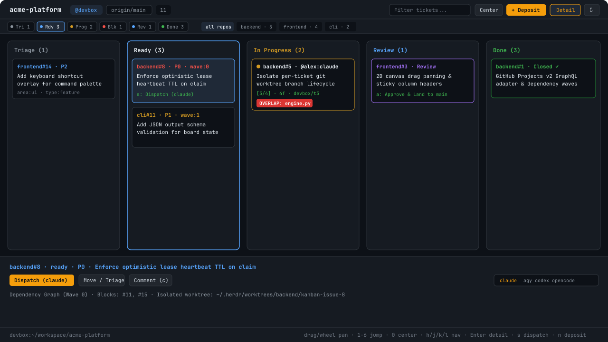

# Herdr Kanban

Multi-colleague, multi-agent GitHub Projects v2 Kanban board (`herdr-kanban`) for Herdr-App. Coordinates isolated Git worktrees, optimistic claim leases, touched-file overlap alerts, dependency waves, rich Markdown descriptions, a "What's New" landed work digest, and one-key agent dispatch across local and remote `hc` machines.

## What you see

- **Streamlined two-row header**:
  - **Row 1**: SVG brand icon (`kanban.svg`), project title, remote peer badge (`@peer-host` when viewing a remote space), shared target branch pill (`origin/main`), segmented **View Switcher** (`Board` | `✦ What's New`), live search box (`search.svg` + `x.svg`), primary `Deposit` button (`plus.svg`), `Inspector` toggle (`panel-right.svg`), and `Refresh` icon button (`refresh.svg`).
  - **Row 2**: Quick-filter pills (`All`, `Active`, `P0`, `Compact Empty: On/Off`, `Center (0)`) paired with a drag/wheel-pannable **Repository Filter strip** (`all repos` plus active-first repo pills showing recessed ticket counts).
- **Adaptive 2D Pannable Kanban canvas**: `Triage`, `Ready`, `In Progress`, `Blocked`, `Review`, and `Done` columns with sticky column headers. Empty columns (`0` tickets) compress to `104px` (`Compact Empty: On`) while active columns expand (`276px–360px`) so `In Progress` and `Done` stay visible without wasted space.
- **High-craft ticket cards (Agent-Colored & Dependency-Aware)**:
  - **Agent-Colored Active Cards (`resolveTicketAgentVisual`)**: Active claimed cards are tinted and framed by the working agent's brand color (`claude` `#e07a5f` + `icons/claude.svg`, `agy` `#4c8bf5` + `icons/antigravity.svg`, `codex` `#7c6ff6` + `icons/codex.svg`, `opencode` `#10b981` + `icons/opencode.svg`, `gemini` `#06b6d4` + `icons/gemini.svg`, `copilot` `#ec4899` + `icons/copilot.svg`) with a 4px left accent stripe, spinning `spinner.svg` while working, and distinct worker colors (`AGENT_WORKER_PALETTE`, `agy #1`, `agy #2`) when multiple agents of the same harness work in parallel.
  - **Dependency Lock Callout Banner (`isDepBlocked`)**: Tickets blocked by unmet upstream dependencies display a 4px left red stripe, dashed border (`border_dashed()`), recessed surface tint, dimmed title, and a full-width **`BLOCKED BY #71 · Wave N`** lock banner (`lock.svg`) with clickable blocker chips that jump directly to the blocking ticket.
  - **Upstream Unblocker Badge**: Unblocked tickets that unblock downstream work display a green `Unblocks #69` pill.
  - **Strict Non-Overlapping Pill Rows**: All card, subbar, and inspector pill rows enforce bounded truncation (`max_w`, `min_w(0)`, `overflow_hidden()`) so pills never overlap or collide at any pane width.
- **Split 2-Column Ticket Inspector (`renderInspector`)**:
  - Compact 2-row header with `Expand`/`Compact` height toggle (`268px` ↔ `410px`), formatted column pill (`In Progress`), unified `Dispatch` + `claude | agy | codex | opencode` selector, `Focus (f)`, `Land (a)`, `Move / Priority`, `Ask Agent (c)`, and outline `Release` button.
  - **Left column**: Claim & worktree card (with `TextView.markdown` status note), Agent Checklist (with visual progress bar and `circle-check.svg` / `square.svg` icons), Dependency Graph chips, and Touched Files.
  - **Right column**: Full `TextView.markdown` description with selectable text and clickable `#issue` / `repo#issue` references (`kanban://issue/...`).
- **What's New View (`renderWhatsNewView`, shortcut `w`)**:
  - Top bar with author attribution, `Synthesize Briefing (s)` (`herdr-kanban whats-new --generate`), `Ask <agent> to Summarize` (launches an agent tab with `herdr-kanban whats-new --prompt`), and `Back to Board (b)`.
  - **Left pane**: Rich `TextView.markdown` Executive Briefing of landed work across repositories and recent Git commits, with clickable ticket links.
  - **Right pane**: `Colleagues & Coding Agents` cards (`landed` vs `active` counts and touched repos), `Landed by Repository` filter chips, and `Recently Landed Tickets` feed.

## How it behaves

- Opens as a docked split panel beside your active terminal (`Ctrl+Shift+M` toggles open/close via `pane.split` / `pane.close`).
- Resolves `{ cwd, on }` from `props()` or the active Herdr space (`spaces()`, `panes()`, `focused()`), scanning candidate pane `cwd`s in the space to find `.herdr-kanban.toml` and passing `{ cwd, on }` to every `exec("herdr-kanban", [...], { cwd, on })` call so remote spaces execute `herdr-kanban` on the space's host machine.
- **2D Panning**: Left-click drag or middle-click drag anywhere on the board (or scroll with a trackpad / mouse wheel / `Shift + wheel`) to pan across columns and cards (`panX`, `panY`). Double-clicking a column header, clicking `Center (0)`, or pressing `0` resets pan to `(0, 0)`.
- **What's New Briefing (`w` / `s`)**: Press `w` (or click `What's New` in the header, or run `herdr-app do herdr-kanban.whats_new`) to switch to the colleague/agent landed work digest. Press `s` inside What's New to run `herdr-kanban whats-new --generate --json` and refresh the briefing from landed tickets and recent Git commits.
- **Keyboard navigation**: `h`/`l` (columns, with auto-pan), `j`/`k` (cards, with auto-pan), `Shift+h/j/k/l` (manual pan), `1`–`6` (jump & pan to column), `0` (reset pan), `w` (toggle What's New), `b` (back to Board), `d`/`Enter`/`Space` (toggle detail drawer), `Shift+D` (toggle tall inspector), `s` (claim & dispatch on Board, or synthesize briefing in What's New), `f` (focus agent), `t` (promote Triage -> Ready or open triage bar), `a` (approve & land Review ticket), `n` (deposit ticket), `c` (ask/comment), `r` (refresh), `Escape`/`q` (close modal, drawer, or pane).

## Built from

- `gpui-kit`: `View`, `div`, `svg`
- `gpui-base`: `v_flex`, `h_flex`, `Button`, `Input`, `InputState`, `TextView`
- `herdr`: `spaces`, `panes`, `agents`, `terminals`, `focused`, `exec`, `run`, `theme`, `closeOverlay`, `notify`, `nextCommand`, `props`

## Watch out

- Never construct `InputState.new(...)` or `cx.focus_handle()` inside `render()` — all inputs (`searchInput`, `depositTitleInput`, `depositBodyInput`, `askInput`) and `this.handle` are created once in `init(cx)`.
- Always pass a multiplier (e.g. `1.38`), not pixels, to `.line_height(n)` on GPUI `div()` elements.
- Always pass `{ cwd, on }` to `exec("herdr-kanban", ...)` so viewing a space hosted on a peer machine runs `herdr-kanban` on the machine that owns the repository checkout and worktrees.
- Never hold `cx` across `await`; use the `cx` provided by `cx.spawn(async (cx) => ...)` and call `cx.notify()` after state updates.

## Done when

- `herdr-app check ~/.config/herdr-app/mods/herdr-kanban` passes with 0 errors and 0 lint warnings both locally and on connected `hc` peers.
- All 6 columns, adaptive empty column compression, `TextView.markdown` descriptions, What's New colleague digest (`w`), inspector drawer, keyboard navigation, and interactive actions work seamlessly.
